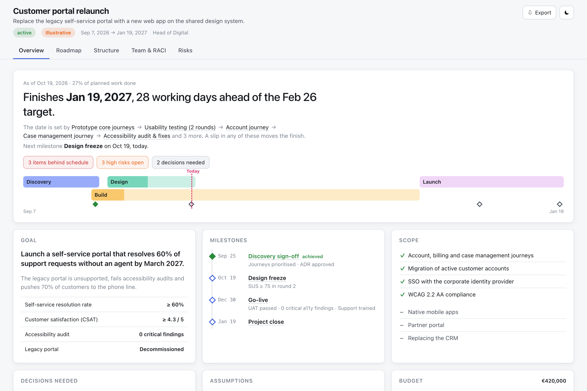
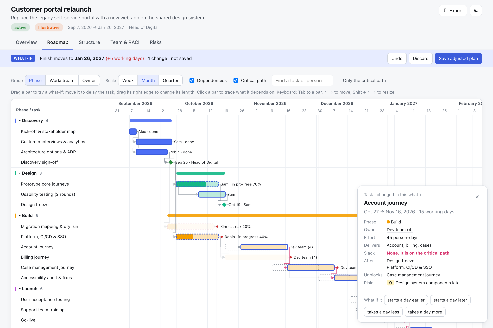

<div align="center">

# planify

**Project plans that say *when*, and *why*.**

An agent skill that turns a project brief into a validated, scheduled project plan,<br>delivered as one standalone HTML file you can open, share, print and argue with.

[**Live demo**](https://filipromeling-max.github.io/planify/examples/customer-portal.html) · [Website](https://filipromeling-max.github.io/planify/) · [Install](#install) · [Plan format](references/authoring-guide.md)

<picture>
  <source media="(prefers-color-scheme: dark)" srcset="docs/assets/overview-dark.png">
  
</picture>

</div>

## Why

Most project-plan templates are dashboards of numbers that don't connect: a date here, a percentage there, a risk list somewhere else. The reader has to work out the answer themselves.

planify treats a plan as a set of **dates that depend on each other**. The agent writes the plan as JSON. A zero-dependency CLI checks it, schedules it on a working-day calendar and computes the critical path. Every view on the page is built on that one schedule, so the page can lead with the answer:

> **Finishes Jan 19, 2027, 28 working days ahead of the Feb 26 target.**
> The date is set by Prototype core journeys → Usability testing → Account journey → Case management journey → …

## What you get

| View | What it answers |
|---|---|
| **Overview** | Will we make it? The finish date against the target, the tasks that set it, what is behind schedule, open decisions, and the phases drawn to scale with milestones and today. |
| **Roadmap** | When does each thing happen, and what depends on what? A Gantt chart grouped by phase, workstream or owner, with FS/SS/FF dependencies, milestones, the critical path, Today and target lines. |
| **Structure** | What are we delivering, and who runs it? Phase gates with exit criteria, a work breakdown structure with roll-up progress, the organisation chart and governance forums. |
| **Team & RACI** | Who owns what? A RACI matrix with one accountable person per row, and workload by role against FTE capacity. |
| **Risks** | What could break it? A 5×5 heat map and a register linked to the tasks each risk threatens. |

Exports: print/PDF (all views), roadmap PNG and SVG, Markdown for Confluence or Notion, a tasks CSV for Excel, Jira or MS Project, and the plan JSON.

### Drag to ask "what if?"

<picture>
  <source media="(prefers-color-scheme: dark)" srcset="docs/assets/roadmap-dark.png">
  
</picture>

Move or stretch any bar on the roadmap, with the mouse or the arrow keys. The real scheduler reruns in the page:

- the finish date and critical path update
- the original dates stay as dashed outlines
- a bar at the top states the consequence, for example *Finish moves to Jan 26, 2027 (+5 working days)*

Undo, discard, or **Save adjusted plan** to download a JSON file your agent can finalize.

Click any person, phase, milestone or risk and the roadmap focuses on it.

## Install

You need Node 18 or later. There are no dependencies to install.

```bash
git clone https://github.com/filipromeling-max/planify.git ~/.claude/skills/planify
```

```bash
node ~/.claude/skills/planify/bin/planify.mjs doctor
```

For agents other than Claude Code, clone the repository into that agent's skills folder. The entry point is [`SKILL.md`](SKILL.md).

## Use

Ask your agent in plain language:

- *Plan our CRM migration. We start 2 Feb and must be live by June.*
- *Turn this statement of work into a project plan with a RACI.*
- *Build a roadmap and risk register for the product launch.*

The skill gathers the goal, start date, scope and people. It asks once if any of these are missing, and marks invented values as **Illustrative**. It then writes the candidate, finalizes it and replies with a link to the page.

### CLI

```bash
node bin/planify.mjs finalize plan.json [out.html]   # validate → schedule → render → check
node bin/planify.mjs validate plan.json              # check and schedule only
node bin/planify.mjs export md plan.json > plan.md   # Markdown summary
node bin/planify.mjs export csv plan.json > tasks.csv
```

When `finalize` fails, it returns error codes with concrete fixes. The agent applies them to the JSON and reruns:

```text
✗ schedule failed with 1 error
  plan/dependency-violation  $.tasks[id=proto].start
    Task "proto" starts 2026-09-08 but its dependencies allow 2026-09-28 at the earliest.
    fix: Start it on 2026-09-28 or later, or remove "start" so the scheduler places it after its dependencies.
```

## How it works

```
brief ──▶ agent writes candidate.plan.json
            │
            ▼
        validate   ids, references, enums, one accountable person per RACI row, no reporting cycles
            │
            ▼
        schedule   working-day calendar + holidays, FS/SS/FF with lag, forward/backward pass, slack, critical path
            │
            ▼
         render    one self-contained HTML file (inline CSS/JS, no network), written atomically, with a receipt
```

A minimal plan:

```json
{
  "schema_version": 1,
  "plan_type": "project",
  "meta": { "title": "Office move", "start": "2026-11-02", "evidence": "illustrative" },
  "tasks": [
    { "id": "pick", "label": "Choose new office", "duration": 10 },
    { "id": "lease", "label": "Sign lease", "duration": 5, "depends_on": ["pick"] },
    { "id": "fitout", "label": "Fit-out", "duration": 15, "depends_on": ["lease"] }
  ],
  "milestones": [{ "id": "move", "label": "Moving day", "depends_on": ["fitout"] }]
}
```

The full format covers phases, workstreams, WBS, roles, governance, RACI, risks, decisions and budget. It is documented in [references/authoring-guide.md](references/authoring-guide.md), with a JSON Schema in [schemas/plan.schema.json](schemas/plan.schema.json) and starter skeletons for software delivery, migrations, consulting engagements, launches, events and change programmes.

## Repository layout

```
SKILL.md                       agent instructions (entry point)
references/authoring-guide.md  every field, rules, patterns per project type
schemas/plan.schema.json       JSON Schema of the candidate
bin/planify.mjs                CLI: finalize | validate | export | doctor
lib/                           validate, calendar, schedule, render, markdown/csv
assets/viewer.{css,js}         the page, inlined at render time
examples/                      sample plans
docs/                          GitHub Pages site and rendered demos
scripts/build-site.mjs         rebuilds docs/examples (npm run site)
```

## Credits

The approach (agent-authored JSON, a checking CLI, standalone HTML) is borrowed from [archify](https://github.com/tt-a1i/archify) by tt-a1i, which does the same for architecture diagrams. planify applies it to project plans.

## Licence

[MIT](LICENSE)
